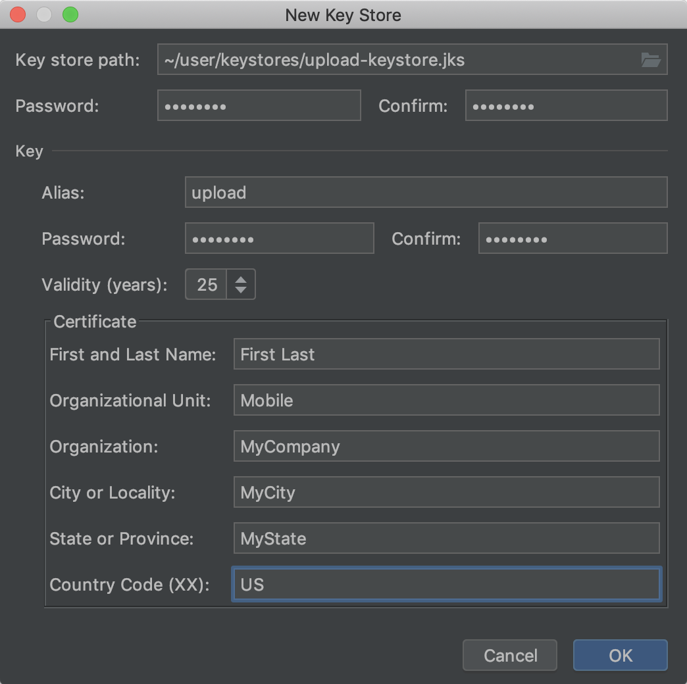

# Google Play: set up your business account

**For:** the app owner or authorised member of staff. You can do this in a browser on Windows, macOS or Linux. Your developer can build the Android app without a Mac.

The aim is to open a verified account owned by your business and invite your developer. You do not need to learn Android Studio to complete the account steps.

## 1. Find an existing account before creating another

If the business already has a Play Console account, ask its owner for access and continue at step 4. If an app is already published through an agency or a former employee, tell your developer first. Do not create a replacement app or key to work around missing access.

Use [Google Play Console](https://play.google.com/console/) for an app distributed through Google Play. Google's separate Android developer-verification service also covers distribution outside Play; it is not an instruction to buy a second account for this Play guide. Ask your developer about outside-Play distribution if that is part of your plan. [Google's developer-verification overview](https://developer.android.com/developer-verification).

## 2. Choose an account type and prepare your details

For a business publishing its own app, choose **Organisation** when it matches your legal status. Google requires a D‑U‑N‑S number for organisation verification, with exceptions handled through support for certain government bodies. Use your legal name and address, not a brand name that differs from the records. Request a missing D‑U‑N‑S number through the official process; Google says the application is free. [Account-type guidance](https://support.google.com/googleplay/android-developer/answer/13634885?hl=en).

Have your business website, contact details, identity/business documents and a payment method ready. Follow the exact verification requests shown for your account; do not send identity documents to your developer unless you have separately agreed a reason and secure method. Google lists a **US$25 one-time registration fee**. Confirm the actual checkout amount before paying. [Registration instructions](https://support.google.com/googleplay/android-developer/answer/6112435?hl=en).

**Personal accounts have different launch requirements.** For personal accounts created after 13 November 2023, Google's current rules require a closed test with at least 12 testers opted in continuously for the preceding 14 days before applying for production access. Internal testing does not satisfy that rule. Allow time for the application and any further testing Google requests. Choose the account type that describes you; do not choose an inaccurate type to avoid testing. [Current personal-account testing rules](https://support.google.com/googleplay/android-developer/answer/14151465?hl=en).

## 3. Register and complete verification

1. Sign in to [Play Console](https://play.google.com/console/) with the Google Account that will remain responsible for the business account. If needed, create one through Google's sign-up route. A Google Account can use an existing business email address.
2. Choose the agreed account type, enter the requested details and read the developer agreement.
3. Arrange payment of the registration fee and keep the receipt.
4. Work through the verification tasks in the console and any follow-up emails. Confirm the contact email and phone number when requested.
5. Set up account recovery and two-step verification. Keep recovery material in your business's password manager.

**Finished when:** you can enter Play Console and its account-verification tasks are complete. An app-specific dashboard may still contain work to do before publication. If verification fails, follow the help link in the console and keep the exact message. Your developer can help interpret it without needing your login. [Google's registration guide](https://support.google.com/googleplay/android-developer/answer/6112435?hl=en).

## 4. Agree the app identity

Ask your developer for the permanent **application ID** (also called the package name), for example `uk.co.yourbusiness.propertyapp`. It is different from the public app title. Do not register this starter's placeholder ID.

Agree who will create the app record in Play Console and authorise that step. The developer should confirm the package name against any existing app before uploading a first build. Creating an account does not automatically create a listing or establish the right signing key.

## 5. Invite the developer

1. Ask for the exact Google Account email address the developer wants to use.
2. In [Play Console](https://play.google.com/console/), open **Users and permissions**, then **Invite new users**.
3. Enter that email. Add an access expiry date if your agreement calls for one.
4. Under **App permissions**, select this app and agree the permissions needed. For an initial test release, this will normally include viewing the app and releasing to testing tracks. If no app exists yet, agree who creates it before granting broader account permissions.
5. Leave financial and production-release permissions off unless their work requires them and you have approved that access. Do not use full account administrator access just to clear an error.
6. Send the invitation. Ask the developer to accept it and confirm they can see the correct app and testing track.

**Finished when:** the user appears active and the developer confirms access. An invitation must be accepted with the exact email you entered. Google's [user and permission guide](https://support.google.com/googleplay/android-developer/answer/9844686?hl=en) explains the available permissions and invitation expiry.

## 6. Agree who holds the upload key

Google Play uses two related keys. The **upload key** signs what your developer uploads. With **Play App Signing**, Google holds the app-signing key used for the version installed from Play. Your developer needs access to the correct upload key; you normally do not download Google's private app-signing key. [How Play App Signing works](https://developer.android.com/studio/publish/app-signing).

If this is an existing app, locate the existing key and account information with the current maintainer. Do not generate a new one before checking continuity and recovery options.

For a new app, ask the developer to propose a key-creation and backup arrangement for your approval. Record who holds the keystore, who can access its passwords and how another authorised developer would recover it. They can create the agreed upload key; you do not need Android Studio just to hand over the account.

If you have explicitly agreed to create it yourself with Android Studio:

1. Ask the developer to open the correct Android project and confirm that a new key is appropriate.
2. Choose **Build → Generate Signed Bundle / APK**, choose **Android App Bundle**, then continue to **Create new** beside the keystore path.
3. Save the keystore in the agreed protected location outside the project. Enter the agreed alias, passwords, validity and business details; ask the developer to review them before confirming.
4. After creation, back up the keystore and record its alias. Store passwords in your password manager. Creating the key does not require continuing through a release or upload.

_Google/Android Open Source Project's example dialog; your Studio version may look different. Use your agreed business details, not the example values. [Source and image licence](images/onboarding/README.md)._

[Google's illustrated signing guide](https://developer.android.com/studio/publish/app-signing#generate-key) shows the actual **New Key Store** dialog and explains its fields. Use that image if your Studio version looks different. Your developer's [credential guide](credentials.md) explains how this project validates an existing keystore without putting secrets in source control.

## 7. Prepare for a test release

Your developer builds a signed **Android App Bundle** (`.aab`) for Play, checks it and uploads it to an agreed testing track. An AAB is a store-upload file, not something a tester taps to install directly. For a direct device test, your developer supplies an installable APK or uses the development tools.

Before the first tester invitation, agree the test audience, support contact and feedback method. Complete the app's required listing and policy tasks with the developer's help. Privacy/data-safety answers must describe your actual finished app, including any backend or third-party SDKs. The starter's default answers do not cover future business features.

Publication is a separate approval. Agree the tested build, store listing, privacy wording and launch date before a production release. See [store publishing](store-publishing.md).

## Send this completion note to your developer

- Organisation or Personal account:
- Account verification complete / outstanding tasks:
- Invitation sent to / accepted:
- App title and agreed package name:
- Existing Play listing, if any:
- Upload key already exists / new-key arrangement needed:
- Who will approve testing and publication:

Do not include passwords or attach a keystore. Agree an encrypted transfer method if an authorised person needs the private file.

Public instructions checked on **1 November 2026**. Account screens may vary by country, account type and app status. Use the official help linked beside each step if labels move. We have not registered or changed your account.
